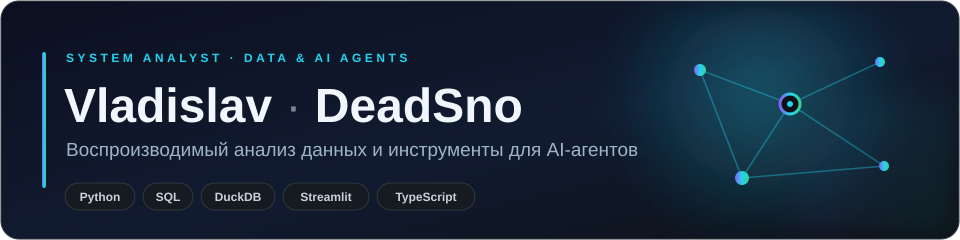

**📍 Саратов, Россия · открытый код · MIT**

## Чем занимаюсь

- **Анализ данных:** SQL и DuckDB → проверяемые выводы, дашборды на Streamlit, открытые данные.
- **AI-инфраструктура:** локальный MCP-сервер и оркестрация задач агентов — cron, DAG, matrix, quality gates, собственный дашборд.
- **Качество:** тесты, аудит данных, явная методология и воспроизводимость экспериментов.

## Проекты

### 🧠 [brain-25-evidence](https://github.com/DeadSno/brain-25-evidence)

Доказательность 130 БАДов: 37 618 статей из PubMed, вердикты по мета-анализам, Hedges' g, калькулятор доз, карта взаимодействий и активные клинические испытания. Два интерфейса — Streamlit для аналитики и статический сайт на GitHub Pages.

[GitHub](https://github.com/DeadSno/brain-25-evidence) · [Live-дашборд](https://brain-25-evidence.streamlit.app) · [Сайт](https://deadsno.github.io/brain-25-evidence/) · [Калькулятор](https://deadsno.github.io/brain-25-evidence/calculator.html)

### ⚙️ [agent-steward](https://github.com/DeadSno/agent-steward)

Локально-первый фреймворк оркестрации агентов: **MCP-сервер** (stdio, 34 инструмента) и плагин OpenCode V1/V2 как точки входа, плюс CLI и standalone. Разовые и cron-задачи в нативном планировщике ОС, DAG-пайплайны, matrix-сборки по нескольким репозиториям, quality gates, история в SQLite и локальный дашборд с метриками. Без SaaS и телеметрии. MIT, интерфейс на RU / EN / 中文 / Türkçe.

[GitHub](https://github.com/DeadSno/agent-steward) · [npm](https://www.npmjs.com/package/agent-steward) · [MCP-настройка](https://github.com/DeadSno/agent-steward/blob/dev/docs/mcp-setup.md) · [Документация](https://github.com/DeadSno/agent-steward#readme)

## Стек

`Python` · `SQL` · `DuckDB` · `pandas` · `Streamlit` · `TypeScript` · `Node.js` · `HTML/CSS/JS` · `SQLite` · `GitHub Actions`

## Сейчас в работе

- Развиваю `agent-steward`: MCP-сервер, кросс-платформенный шедулер, мультирепозиторий-задачи и наблюдаемость.
- Поддерживаю данные `brain-25-evidence` в актуальном состоянии: квартальный аудит PMID и обновление мета-анализов.

## Связаться

[Telegram](https://t.me/Sno1613) · [VK](https://vk.ru/id861097328) · [Max](https://web.max.ru/-69447423358448) · [Pikabu](https://pikabu.ru/@DeadSno64)

---

*Бейджи обновляются автоматически: звёзды и дата последнего коммита всегда актуальны.*
